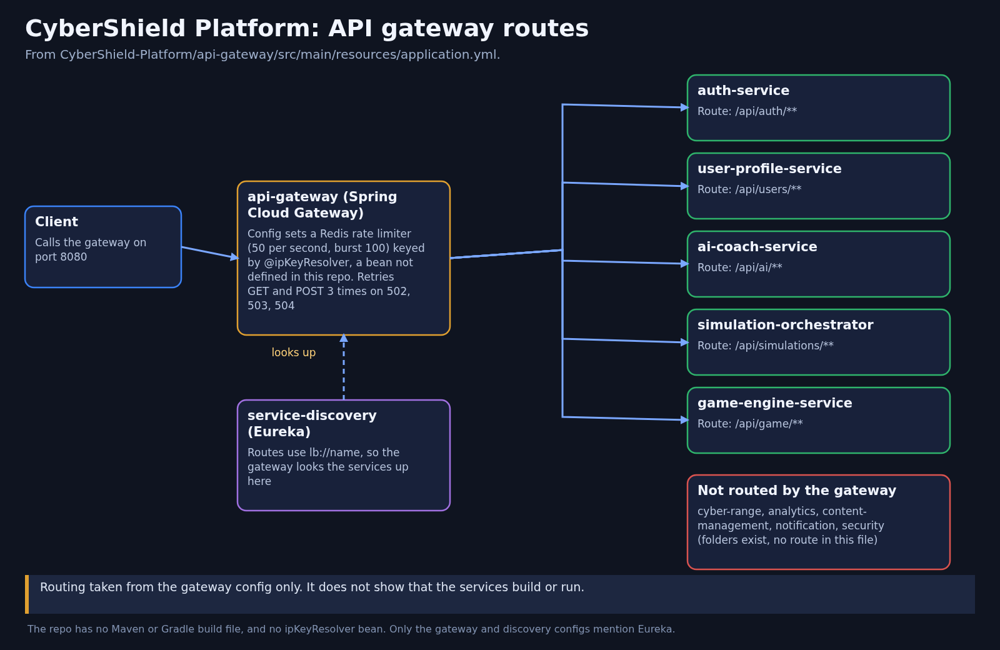

# CyberShield-Academy
A specialized academy providing hands-on, real-world cybersecurity training through a Cyber Range and simulations. Its mission is to quickly qualify professionals in essential skills like ethical hacking and incident response to meet the global demand for cyber defenders.

## Gateway routes

How `CyberShield-Platform/api-gateway` routes requests, from its `application.yml`. The diagram shows routing only, not that each service is complete or running.

## Build status

What was run (Node 20, local, not hosted CI):

| Part | Result |
| --- | --- |
| `admin-dashboard` | `npm install` and `npm run build` succeed (React, Vite, MUI). |
| `frontend` | `npm run typecheck` reports 0 errors. `npm run build` succeeds (needs about 2 GB of RAM; the heap limit is set in the script) and mounts the existing control panel and the 3D cyber city view from `src/main.tsx`. `three` was raised to ^0.167 (the version the typings already target) because the old one broke the build. |
| `backend` | Not runnable. It holds a user model, two services and two engine files, with no server entry, routes or Dockerfile. |
| `CyberShield-Platform` | 10 Java service folders with no `pom.xml` or Gradle files, so nothing builds. |
| `docker-compose.yml` | Only `frontend` has a Dockerfile (added, not run in Docker). The other services still lack one, so the full stack does not start. |

The frontend calls `/api/*` endpoints that this repository does not implement, so its data panels stay empty until a backend exists.
